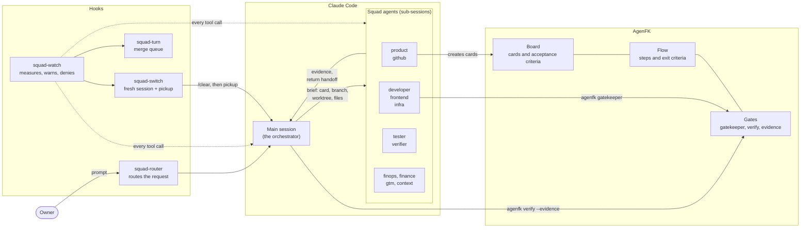

# agenfk-squad

[](https://github.com/eduardopin/agenfk-squad/actions/workflows/tests.yml)
[](LICENSE)

**A squad of twelve Claude Code agents, and a watcher that keeps them honest, built on [AgenFK](https://github.com/cglab-public/agenfk).**

AgenFK gives an AI coding session a board, a flow and gates: no card, no edit; no
evidence, no next step. The squad adds what a single gated session still lacks
once you run several of them at the same time:

- **Roles with hard limits.** One agent per job, each with a fixed set of tools.
  The one that reviews cannot edit. The one that writes infrastructure stops at `plan`.
- **A watcher that measures instead of asking.** A hook reads every session's
  transcript once a minute and acts on the numbers: it orders a handoff before
  the context window fills, cuts a sub-session that loops, refuses a new
  dispatch when the orchestrator is already too heavy, and makes merges to the
  main branch take turns.
- **A way out of every refusal.** The watcher never just says no. Each denial
  tells the session where the work continues: here, in a fresh session, or with
  the owner.

It is a small thing: Markdown prompts, four Python hooks with no dependencies
beyond the standard library, and one test suite. It is also an open question.
The rules here came from watching real sessions fail, and there are many
failures we have not seen yet. If you run AI agents in parallel, we want your
evidence and your rules. See [Contributing](#contributing).

## The problem

Give a capable model a large task and permission to spawn sub-agents, and four
things go wrong, in this order.

1. **Context becomes the largest cost, and nobody is watching it.** A session
   at 600k tokens of context pays for those 600k again on every turn. It also
   reasons worse. The session itself is a poor judge of when to stop: it either
   stops far too early ("my context is getting high") or never.
2. **Orchestrators fan out without limit.** Sub-agents feel free to the session
   that spawns them. They are not.
3. **The author approves its own work.** A session that wrote the code, asked to
   review it, finds it correct. Asked again, it finds it correct again.
4. **Parallel sessions collide at the merge.** Each merge moves the main branch
   under the others. Every session then resolves the same conflict, and the
   resolution is stale by the time it is pushed.

The limits in this repository were set after one week in October 2026, on one
machine, running five projects:

| What was measured | Value |
|---|---|
| Context of the orchestrating sessions | 420k to 966k tokens |
| Sub-agents spawned | 249 |
| Share of all token consumption that went to sub-agents | 64% |
| Projects orchestrating at the same time, overnight | 5 |
| Times a single card was sent to review | 5 |

None of those sessions was misbehaving by its own lights. Each step was
reasonable. The squad exists because reasonable steps add up to that table.

## How it fits together



Three layers, each doing one job:

| Layer | What it owns | What it refuses |
|---|---|---|
| **AgenFK** | The card, the flow, the evidence for each step | Editing without a card; advancing without evidence |
| **Squad agents** | One role each, with a fixed tool list | Approving your own code; merging, applying, deploying, publishing |
| **Watcher hooks** | The context budget, the dispatch limits, the merge queue | A dispatch from a session that is too heavy; a merge out of turn; a looping sub-session |

The flow that ties the layers together ships in
[`flows/squad-delivery.json`](flows/squad-delivery.json): each step names the
agent that owns it and the evidence `agenfk verify` has to carry.
[docs/agenfk-integration.md](docs/agenfk-integration.md) has the full table.

## The agents

| Agent | Role | Writes? | Model |
|---|---|---|---|
| `product` | Says where the project really is, cuts the goal to the smallest usable increment, breaks it into cards | No (creates cards in TODO) | inherit |
| `github` | Maps who is in which worktree and branch, plans parallel fronts over disjoint files, proposes the merge train | Worktree claims only | inherit |
| `developer` | Turns exactly one card into code, on its own branch and worktree | Yes | inherit |
| `frontend` | Interface, components, design systems, motion, visual pieces, with a measured quality floor | Yes | inherit |
| `tester` | Writes the card's tests and proves by mutation that each one can fail | Test files only | Sonnet |
| `verifier` | Independent review in a clean context: REVIEW, ADVERSARIAL, MUTATE, VERIFY. Returns `SHIP`, `FIX_FIRST` or `REJECT` | No | Sonnet |
| `pull-request-reviewer` | Reviews an open PR for the human reviewers and prints what it does and its findings. Runs `pr-review`, which uses the newest DeepSeek flash through pi | No | Haiku, review on DeepSeek |
| `infra` | Terraform, CI/CD, Dockerfiles. Stops at `plan` | Yes, never `apply` | inherit |
| `finops` | Prices a cloud design line by line; measures token spend per card and model | No | inherit |
| `finance` | Unit economics, pricing, margin, break-even | No | inherit |
| `gtm` | Positioning, competitors, landing copy, outreach scripts | No (drafts only) | inherit |
| `context` | Measures context, burn and rereading per session; decides continue, compact, hand off or cut | Handoffs and card comments only | Sonnet |

Full catalogue with limits: [docs/agents.md](docs/agents.md).

## The watcher in one screen

`hooks/squad-watch.py` runs on five Claude Code hook events and speaks to the
session in messages that start with `[squad-watch]`.

| It sees | It does |
|---|---|
| Main session at 80% of its window, or rereading itself for 60% of its spend above a floor that weighs how much it has already burned | `PROACTIVE HANDOFF`: the session writes a handoff and stops; the watcher clears the pane and a fresh session picks the work up |
| A sub-session repeating the same call, or past 180k of context | Denies the call; the sub-session returns a short handoff to its parent |
| An orchestrator at 600k of context, or with 40 sub-sessions, or a fourth session orchestrating at once, or a seventh reviewer on one card | `DISPATCH DENIED`, with the way forward spelled out |
| A merge to main while another session holds the turn | Denies it, queues the session, and wakes it with `MERGE TURN` |

Every threshold is an environment variable. The arithmetic, with worked
examples, is in [docs/watcher.md](docs/watcher.md).

## Quickstart

You need Claude Code, Python 3.10 or newer, `git`, and AgenFK.

```bash
# 1. AgenFK first: the squad assumes its CLI is on your PATH
#    https://github.com/cglab-public/agenfk#installation--setup

# 2. The squad
git clone https://github.com/eduardopin/agenfk-squad.git
cd agenfk-squad
./install.sh          # symlinks into ~/.claude; never overwrites a real file

# 3. Register the hooks in ~/.claude/settings.json
#    (snippet in docs/installation.md)

# 4. See what your sessions are costing right now
python3 skills/session-context/scripts/session_context.py --detail
```

`install.sh` links `CLAUDE.md` as your **global** Claude Code instructions. If
you already have a `~/.claude/CLAUDE.md`, the installer skips it and tells you;
merge the two by hand. Read [docs/installation.md](docs/installation.md) before
running it on a machine you care about.

Then open a project that has an AgenFK board and ask for something:

```
> start the export-to-CSV feature
[squad route] product -> `product` agent (real state of the repo, smallest increment, cards in AgenFK).
```

## Documentation

| Read this | To learn |
|---|---|
| [docs/concepts.md](docs/concepts.md) | The five principles and the evidence behind each |
| [docs/architecture.md](docs/architecture.md) | Hooks and events, state on disk, one card from start to finish |
| [docs/agents.md](docs/agents.md) | Each agent: role, tools, model, limits, when it is dispatched |
| [docs/watcher.md](docs/watcher.md) | The handoff arithmetic, the dispatch brake, the soft stop, the session switch, the merge queue |
| [docs/agenfk-integration.md](docs/agenfk-integration.md) | Flow step → agent → AgenFK command → evidence; how to activate the flow |
| [docs/configuration.md](docs/configuration.md) | Every `SQUAD_*` variable and its default |
| [docs/installation.md](docs/installation.md) | Requirements, what the installer links, the `settings.json` hooks, uninstalling |
| [ROADMAP.md](ROADMAP.md) | What is missing, and where help is most useful |

## Skills

| Skill | What it is |
|---|---|
| `session-context` | Context indicators for Claude Code, Codex and pi sessions (`scripts/session_context.py`), the thresholds, and the protocol for switching tasks |
| `clear-pickup` | Writes a handoff file from ground truth (git state plus session state) before a context clear, and reloads it afterwards |
| `parallel-git` | One card = one branch = one worktree = one session; disjoint fronts; writer claims; merge train with squash and `rebase --onto` |
| `design-reference` | One design method: direction before code, a verifiable quality floor, the patterns that give away AI-generated UI, motion with rules |
| `vendor/canvas-design`, `vendor/algorithmic-art` | Third-party skills by Anthropic, Apache-2.0, redistributed unmodified (see [NOTICE](NOTICE)) |

## Specialising for one project

A file in `<project>/.claude/agents/` with the **same name** replaces the squad
agent in that project. Most of the time you do not need one: write the rules in
the project's `CLAUDE.md` or `AGENTS.md`. Every squad agent reads those before
it acts, and they take precedence over this repository, as does the project's
AgenFK flow. A `DESIGN.md` at the root guides `frontend`.

## Status

This is the working setup of one person, published as it is. It runs daily on
Linux with Claude Code. The automatic session switch depends on the
[herdr](docs/installation.md#optional-dependencies) pane manager; without it the watcher still
orders the handoff and you type `/clear` and `/clear-pickup pickup` yourself.
The session report reads Codex and pi transcripts too, but the hooks only
drive Claude Code. [ROADMAP.md](ROADMAP.md) lists what that leaves open.

## Contributing

The concept is young and the sample is one machine. The most valuable
contribution is not code: it is **a failure you observed, with numbers**, and
the rule that would have prevented it.

- Ran the watcher and it cut a session too early, or too late? Open an issue
  with what `session_context.py --detail` showed.
- Have an agent role that earned its place in two projects? Propose it.
- Use another harness (Codex, pi, Gemini CLI, OpenCode)? The hooks are the
  part that does not travel yet.

Start with [CONTRIBUTING.md](CONTRIBUTING.md). The house rule: a new role
enters only after it has shown up in two projects, and every hook change comes
with a test that fails without it.

## License and credits

[ISC](LICENSE), the same license as AgenFK. Third-party skills under
`skills/vendor/` keep their own license; see [NOTICE](NOTICE).

AgenFK is developed by [CG/lab](https://github.com/cglab-public/agenfk). This
project is an independent companion to it, not part of it.
