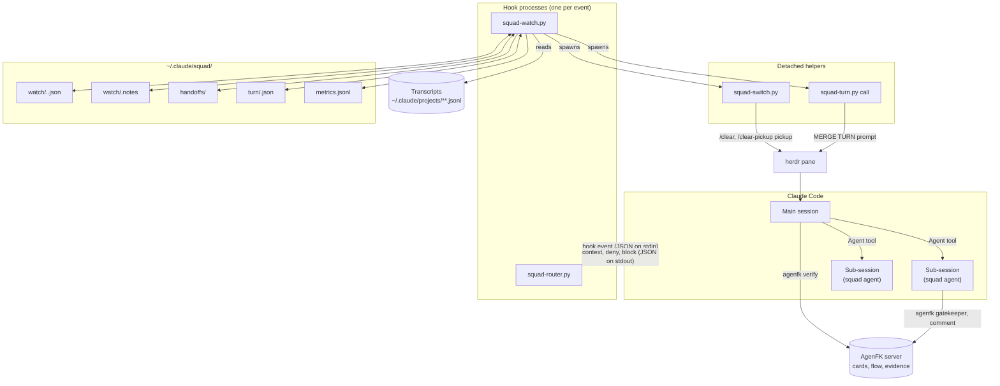

# Architecture

The squad is three kinds of file and one directory of state.

```
agenfk-squad/
├── CLAUDE.md                 global rules every session loads: who does what, dispatch rules
├── agents/*.md               twelve agent definitions (frontmatter: name, description, tools, model)
├── skills/
│   ├── session-context/      the session report and the handoff arithmetic (scripts/session_context.py)
│   ├── clear-pickup/         handoff (write) and pickup (read) across a context clear
│   ├── parallel-git/         branches, worktrees, PR stacks, merge train
│   ├── design-reference/     the design method and quality floor used by `frontend`
│   └── vendor/               third-party skills, Apache-2.0, unmodified
├── hooks/
│   ├── squad-router.py       UserPromptSubmit: suggests the agent for the request
│   ├── squad-watch.py        the watcher: five hook events
│   ├── squad-switch.py       detached: clears the pane and calls the pickup
│   └── squad-turn.py         the merge queue CLI (`squad-turn`)
├── flows/squad-delivery.json the AgenFK flow whose steps match the agents
├── tests/test_watch.py       the suite
└── install.sh                symlinks all of the above into ~/.claude
```

Nothing is compiled, nothing is installed with a package manager, and no
process runs in the background. The hooks are started by Claude Code, do their
work in a few milliseconds, and exit.

## The pieces and who talks to whom



## Hook events

Claude Code runs a hook command for each event and passes a JSON payload on
stdin. The watcher is one script that looks at `hook_event_name` and branches.

| Event | Fires | Script | Can it block? |
|---|---|---|---|
| `UserPromptSubmit` | The owner sends a prompt | `squad-router.py` | No. Prints a routing hint as context |
| `UserPromptSubmit` | The owner sends a prompt | `squad-watch.py` | No. Delivers pending notes (a sub-session ended badly, `SLOT FREE`, `MERGE TURN`) |
| `PreToolUse` | Before any tool call | `squad-watch.py` | Yes. Returns `permissionDecision: deny` with the reason |
| `PostToolUse` | After any tool call | `squad-watch.py` | No. Adds context: warnings, `PROACTIVE HANDOFF` |
| `SubagentStop` | A sub-session ends | `squad-watch.py` | No. Records metrics, leaves a note for the parent |
| `Stop` | The main session ends its turn | `squad-watch.py` | Yes. Returns `decision: block` when a handoff is owed |

The router is separate on purpose: it is seventy lines of regular expressions
with no state, and it should keep working if the watcher is switched off.

### What "deny" looks like to the model

A `PreToolUse` denial returns the reason as text the model reads in place of
the tool result. That text is the whole interface, which is why each one is
written as an instruction: what was refused, the measured number that caused
it, and what to do next. See
[concepts.md](concepts.md#4-every-refusal-comes-with-a-way-forward).

### Failing open

The watcher wraps its entry point so that any exception is logged to
`watch-errors.log` and the process exits 0 with no output. A bug in a hook
must never take a working session down. The cost is that a broken rule fails
silently, which is what the test suite is for.

An environment value that does not parse falls back to the default: a mistyped
threshold must not disable the watcher. The percentages are also clamped to a
sane range; the absolute ceilings are not, so a zero or negative ceiling
denies everything it governs.

Tool and agent names that come from the payload pass through a cleaner that
strips control characters and escape sequences before being printed, since
whatever the watcher prints is read by a model as trusted text.

## State on disk

Everything lives under `~/.claude/squad/`. It is all plain JSON or text, safe
to read and safe to delete: the worst outcome of deleting it is that counters
restart.

| Path | Written by | Contents |
|---|---|---|
| `watch/<session>.main.json` | watcher | Main session: recent call hashes, transcript offset and token totals, alert level and time, sub-session count, pending notes, whether a switch was launched |
| `watch/<session>.<agent>.json` | watcher | The same, for one sub-session |
| `watch/<session>.notes` | watcher | Notes waiting for the session's next prompt |
| `handoffs/<session>-dispatches.md` | watcher | The full brief of every denied dispatch |
| `handoffs/<session>-watch.md` | watcher | The minimal handoff the watcher writes when a session will not |
| `handoffs/<session>-<hash>.md` | watcher | The read-only, hash-checked copy handed to the pickup |
| `turn/<repo-hash>.json` | watcher | Per repository: who holds the merge turn, since when, the queue |
| `metrics.jsonl` | watcher | One line per finished sub-session |
| `switches.log` | `squad-switch.py` | Each step of every session switch, and why it gave up when it did |
| `watch-errors.log` | watcher | Exceptions swallowed by the fail-open wrapper |

Handoffs written by a session itself go where the `clear-pickup` skill puts
them: `<repo>/.claude/handoffs/`, or `~/.claude/handoffs/` when that is not
writable.

State files are written to a temporary name and renamed into place, so a
concurrent reader never sees half a file. The merge queue takes a file lock,
because two sessions can ask for the turn in the same second.

## One card, start to finish

A feature request, with the default configuration and the `Squad Delivery` flow.

```mermaid
sequenceDiagram
    autonumber
    actor O as Owner
    participant M as Main session
    participant W as Watcher
    participant A as AgenFK
    participant P as product
    participant G as github
    participant D as developer
    participant T as tester
    participant V as verifier

    O->>M: "start the CSV export feature"
    Note over M: router hint: product
    M->>P: brief: goal, repo
    P->>A: create cards in TODO
    P-->>M: cards, acceptance criteria, dependencies
    M->>G: two cards will run in parallel
    G-->>M: map: worktree, branch, card; disjoint files
    M->>D: card id, branch, worktree, files
    W-->>M: (PreToolUse) dispatch allowed
    D->>A: agenfk gatekeeper --item-id
    D-->>M: commits, suite result
    M->>A: agenfk verify (IMPLEMENT evidence)
    M->>T: card id, branch
    T-->>M: tests added, each shown to fail
    M->>A: agenfk verify (TEST evidence)
    M->>V: card id, branch (no narrative)
    V-->>M: FIX_FIRST: 2 findings
    M->>D: only the findings
    D-->>M: fixes
    M->>V: card id, branch
    V-->>M: SHIP
    M->>A: agenfk verify (REVIEW ... VERIFY)
    M->>G: open the PR
    M->>W: squad-turn request 42
    W-->>M: the turn is yours
    M->>M: fetch, merge origin/main once, suite, push, merge
    W-->>M: PR MERGED, turn released
```

What the diagram leaves out is the watcher's steady work underneath. On every
tool call of every participant it records the call; once a minute it
re-measures. Three things can then change the picture:

- **The `developer` loops** on a failing command. The fifth identical call is
  denied, the sub-session returns a twelve-line handoff, and the main session
  dispatches only what is missing.
- **The main session crosses its handoff threshold** somewhere around step 12.
  It gets `PROACTIVE HANDOFF`, finishes the step, writes the handoff with steps
  13 onward under `## Next step`, and stops. `squad-switch.py` clears the pane;
  the fresh session reads the handoff, checks it against git, and continues
  at step 13 with 40k of context instead of 600k.
- **Another session holds the merge turn** at step 23. The merge is denied,
  this session joins the queue and moves to the next card. When `MERGE TURN`
  arrives it syncs with main once and merges.

## Design choices worth knowing

**Hooks, not a daemon.** A hook sees every tool call at the moment it happens
and can refuse it. A daemon watching transcripts can only comment afterwards.
The price is that the watcher must be fast and must hold its state on disk
between invocations.

**Standard library only.** The hooks run inside someone else's session, on
whatever Python is on the PATH. A missing dependency would mean a hook that
fails on every tool call.

**Measure the transcript, do not ask the model.** The transcript holds the
token usage of every request as the API reported it. That is ground truth; a
model's sense of its own context is not.

**Text is the interface.** There is no protocol between the watcher and the
session beyond keywords in capitals (`PROACTIVE HANDOFF`, `DISPATCH DENIED`,
`MERGE TURN`) that `CLAUDE.md` teaches the session to act on. The tests assert
on those keywords, so a change to one is a change to an API.

**One writer per file.** Agents are prompts, and a prompt cannot stop two
agents from editing the same file. Worktrees can. Isolation is done with the
filesystem wherever it is possible.
